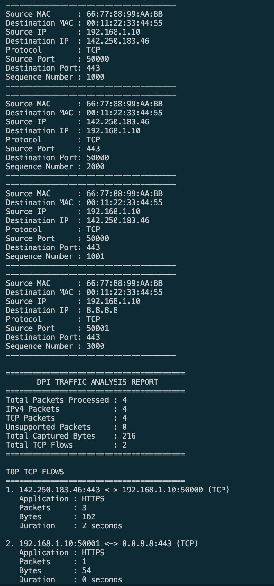
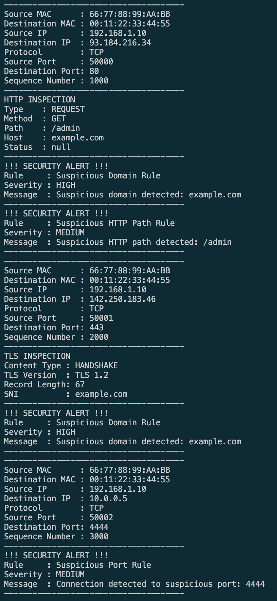
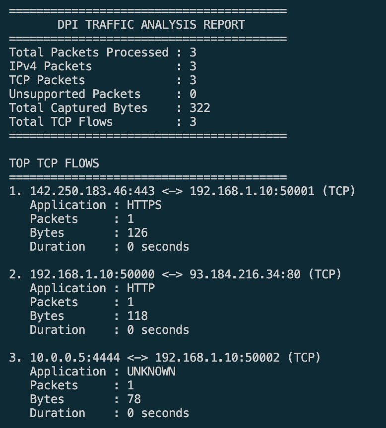

# Deep Packet Inspection & Network Traffic Analysis Engine

A Java-based Deep Packet Inspection (DPI) and Network Traffic Analysis Engine that reads PCAP files, parses network protocols, inspects application-layer traffic, tracks TCP flows, extracts TLS metadata, and generates rule-based security alerts.

---

## Features

- Reads packets directly from PCAP files
- Parses PCAP global and packet headers
- Parses Ethernet frames and extracts MAC addresses and EtherType
- Parses IPv4 packets with variable header lengths
- Parses TCP headers and extracts TCP payloads
- Parses UDP headers and extracts UDP datagrams
- Tracks bidirectional TCP flows
- Reassembles TCP payload streams using sequence numbers
- Buffers and reconstructs HTTP messages across multiple TCP segments
- Supports multiple HTTP requests within a single TCP flow
- Generates traffic statistics and flow analysis reports
- Classifies supported network traffic using a protocol classifier
- Detects and parses HTTP traffic
- Extracts HTTP request metadata:
  - Method
  - Path
  - HTTP Version
  - Host
  - Content-Length
  - Request body, when available
- Detects TLS records and parses TLS ClientHello messages
- Extracts TLS metadata, including Server Name Indication (SNI), when available
- Parses DNS queries and responses to extract:
  - Transaction ID
  - Query name
  - Record type
  - Question and answer counts
  - Response code
- Supports extensible rule-based security inspection
- Loads configurable security rules from `rules.json`
- Generates security alerts for:
  - Suspicious domains
  - Suspicious destination ports
  - Suspicious HTTP paths
- Prints packet details, application-layer inspection results, and security alerts
- Generates a final traffic analysis report
- Saves console output to `reports/dpi-report.log` while continuing to display it in the console

---

# Architecture

```text

                         PCAP FILE
                             |
                             v
                         PcapReader
                             |
                             v
                          RawPacket
                             |
                             v
                        PacketParser
                             |
             +---------------+---------------+
             |               |               |
             v               v               v
       EthernetParser    IPv4Parser      Other Parsers
                             |
                             v
                        ParsedPacket
                             |
           +-----------------+------------------+
           |                 |                  |
           v                 v                  v
    TrafficStatistics   FlowTracker      PacketInspector
                                                |
                                   +------------+------------+
                                   |            |            |
                                   v            v            v
                               HTTPParser   TLSParser    DNSParser
                                   |            |            |
                                   v            v            v
                                HttpInfo     TlsInfo      DNSInfo
                                                |
                                                v
                                               SNI
                                   +------------+------------+
                                                |
                                                v
                                        InspectionResult
                                                |
                                                v
                                           RuleEngine
                                                |
                         +----------------------+----------------------+
                         |                      |                      |
                         v                      v                      v
                SuspiciousDomainRule   SuspiciousPortRule   SuspiciousHttpPathRule
                         |                      |                      |
                         +----------------------+----------------------+
                                                |
                                                v
                                          SecurityAlert


                  TCP STREAM REASSEMBLY PIPELINE
                  ==============================

                         ParsedPacket
                              |
                              v
                     TCPStreamReassembler
                              |
                 +------------+------------+
                 |                         |
                 v                         v
          TCP sequence tracking      Out-of-order buffering
                 |                         |
                 +------------+------------+
                              |
                              v
                         TCPStreamData
                              |
                              v
                      TCPApplicationBuffer
                              |
                 +------------+------------+
                 |                         |
                 v                         v
         HTTP header buffering      HTTP body buffering
                 |                         |
                 +------------+------------+
                              |
                              v
                   Complete HTTP Messages
                              |
                              v
                           HttpInfo
                              |
                              v
                       InspectionResult
                              |
                              v
                          RuleEngine
                              |
                              v
                        SecurityAlert


                       OUTPUT / REPORTING
                       ==================

       ParsedPacket                    InspectionResult
            |                                |
            v                                v
       PacketPrinter              ApplicationLayerPrinter
            |                     - HTTP inspection
            |                     - TLS / SNI inspection
            |                     - DNS inspection
            |                     - Reassembled HTTP
            |                     - Security alerts
            |                                |
            +---------------+----------------+
                            |
                            v
                      Console Output
                            |
                            v
                      ConsoleFileTee
                            |
                            v
                    reports/dpi-report.log


       TrafficStatistics + FlowTracker
                    |
                    v
               ReportPrinter
                    |
                    v
          Final Traffic Analysis Report
                    |
                    v
              Console + Report File
```

---

# Project Structure

```text
src/main/java/com/devansh/dpi
│
├── Main.java
│
├── application
│   ├── HTTPParser.java
│   ├── TLSParser.java
│   └── DNSParser.java
│
├── classifier
│   └── ProtocolClassifier.java
│
├── config
│   ├── DpiConfig.java
│   └── RuleConfigLoader.java
│
├── enums
│   ├── TransportProtocol.java
│   ├── TlsContentType.java
│   ├── EtherType.java
│   └── ApplicationProtocol.java
│
├── inspection
│   ├── InspectionResult.java
│   └── PacketInspector.java
│
├── model
│   ├── RawPacket.java
│   ├── PcapGlobalHeader.java
│   ├── PcapPacketHeader.java
│   ├── EthernetFrame.java
│   ├── IPv4Packet.java
│   ├── TCPPacket.java
│   ├── UDPPacket.java
│   ├── HttpInfo.java
│   ├── TlsInfo.java
│   ├── DNSInfo.java
│   └── TCPStreamData.java
│
├── parser
│   ├── PacketParser.java
│   ├── EthernetParser.java
│   ├── IPv4Parser.java
│   ├── TCPParser.java
│   ├── UDPParser.java
│   └── ParsedPacket.java
│
├── reader
│   └── PcapReader.java
│
├── rule
│   ├── Rule.java
│   ├── RuleEngine.java
│   ├── SecurityAlert.java
│   ├── SuspiciousDomainRule.java
│   ├── SuspiciousPortRule.java
│   └── SuspiciousHttpPathRule.java
│
├── statistics
│   └── TrafficStatistics.java
│
├── tracker
│   ├── Flow.java
│   ├── FlowKey.java
│   ├── FlowTracker.java
│   ├── TCPStreamReassembler.java
│   └── TCPApplicationBuffer.java
│
└── util
    ├── ByteUtils.java
    ├── PacketPrinter.java
    ├── ReportPrinter.java
    ├── ApplicationLayerPrinter.java
    └── ConsoleFileTee.java
```

---

# Component Overview

## `PcapReader`

`PcapReader` handles the binary PCAP file format. It reads the global header, validates the file's magic number, reads per-packet headers, and returns each packet as a `RawPacket`.

Its responsibility is file I/O and PCAP record handling, not decoding Ethernet, IP, transport, or application protocols.

## `RawPacket`

`RawPacket` represents a captured packet as raw bytes together with its PCAP packet metadata. The protocol parsing layer uses these bytes to decode packet headers and payloads.

## `PacketParser`

`PacketParser` coordinates the lower-layer parsing pipeline. It invokes the Ethernet and IPv4 parsers and then parses supported transport headers, including TCP and UDP. The result is represented by `ParsedPacket`.

The parser classes keep protocol-specific logic separate rather than placing all binary parsing in one large class.

## Protocol parsers

### `EthernetParser`

Extracts Ethernet frame metadata, including source and destination MAC addresses and EtherType.

### `IPv4Parser`

Extracts IPv4 metadata, including source and destination addresses, header length, TTL, and the encapsulated transport protocol. The IPv4 IHL field is used to determine the IPv4 header length.

### `TCPParser`

Extracts TCP metadata such as source and destination ports, sequence number, acknowledgement number, flags, header length, and payload offset.

### `UDPParser`

Parses UDP source and destination ports, datagram length, and payload boundaries. UDP packets can be inspected independently of TCP stream reassembly.

## `ParsedPacket`

`ParsedPacket` is the common representation used by downstream components. It exposes parsed network and transport metadata so that inspection, tracking, statistics, and printing components do not need to repeat the lower-level parsing process.

---
# Application-Layer Inspection

## `PacketInspector`

`PacketInspector` coordinates application-protocol inspection for a parsed packet. It delegates protocol-specific parsing to the relevant application parser and packages any detected metadata into an `InspectionResult`.

The project includes HTTP, TLS metadata, and DNS parsing. The exact information available depends on the protocol, packet contents, and whether enough data is present in the captured packet or reconstructed stream.

## HTTP inspection

`HTTPParser` recognizes supported HTTP request and response data and extracts metadata such as:

- Request method
- Request path
- HTTP version
- Host header
- Response status code, when present
- Content-Length and body information where available

For example, a request such as:

```http
GET /login HTTP/1.1
Host: example.com
```

can produce metadata similar to:

```text
Type    : REQUEST
Method  : GET
Path    : /login
Host    : example.com
Version : HTTP/1.1
```

The HTTP parser is designed to avoid treating an incomplete header as a complete HTTP message. TCP stream reassembly and application buffering provide the additional context needed when a message is split across captured TCP segments.

## TLS inspection and SNI extraction

`TLSParser` performs metadata-based inspection of supported TLS records. When a suitable ClientHello is available, it can extract information such as:

- TLS content type
- TLS version information from the record
- Record length
- Server Name Indication (SNI), when present and parseable

Example:

```text
TLS INSPECTION
Content Type : HANDSHAKE
TLS Version  : TLS 1.2
SNI          : example.com
```

This is metadata inspection, not TLS decryption. The engine does not decrypt HTTPS application data.

## DNS inspection

`DNSParser` parses supported DNS message metadata from UDP traffic, including:

- Transaction ID
- Query or response indicator
- Query name
- Question record type
- Question count
- Answer count
- Response code

The current parser focuses on DNS header and question metadata. Do not interpret the displayed answer count as proof that all DNS answer records are decoded and presented individually.

---
# TCP Stream Reassembly

TCP is a byte stream, but a PCAP capture contains individual packets. An application message may be split across multiple TCP segments, and one segment may contain data from more than one application message. For this reason, the project includes a stream-aware processing path.

## `TCPStreamReassembler`

The reassembler tracks TCP payload sequence positions per flow direction. It joins contiguous payload data and holds segments that arrive ahead of the next expected sequence position until the missing data becomes available. It also includes handling for connection lifecycle events and bounds on tracked state.

## `TCPStreamData`

`TCPStreamData` represents a contiguous reconstructed piece of TCP payload data, associated with its flow and direction.

## `TCPApplicationBuffer`

`TCPApplicationBuffer` accumulates reconstructed TCP data until complete HTTP messages can be identified. It accounts for the end of the HTTP header and uses `Content-Length` when determining whether a message body has arrived. It can emit multiple HTTP messages from a single stream buffer and retain any trailing bytes for subsequent processing.

This enables the engine to inspect scenarios such as:

- HTTP headers split across TCP segments
- HTTP request bodies split across TCP segments
- Multiple HTTP requests sent over one TCP connection

TCP stream reassembly is an MVP implementation. It should not be described as a fully RFC-compliant TCP stack; retransmissions, overlapping segments, sequence-number wraparound, missing capture data, and unusual connection teardown patterns can require additional handling and testing.

---
# `InspectionResult`

`InspectionResult` combines a parsed packet with application-layer information detected for that packet or reconstructed HTTP message. It acts as the input to security rules, keeping rule logic separate from protocol parsing.

For reconstructed HTTP, the engine creates an inspection result from the reconstructed `HttpInfo` and evaluates the same rule engine against it.

---
# Flow Tracking and Traffic Statistics

## `FlowTracker` and `FlowKey`

`FlowTracker` groups packets into logical TCP flows. `FlowKey` provides a normalized identity for a connection so traffic in opposite directions can be associated with the same flow. `Flow` stores flow-level information used by the traffic report.

Flow tracking enables the report to summarize communication sessions rather than treating each packet as an unrelated event.

## `TrafficStatistics`

`TrafficStatistics` maintains aggregate capture statistics, including packet counts, IPv4/TCP/UDP counts, captured bytes, and other counters supported by the implementation.

## `ProtocolClassifier`

`ProtocolClassifier` is a separate component for classifying supported traffic according to the implemented classification logic. Its presence does not imply that every application protocol or encrypted application payload can be identified.

---
# Security Rule Engine

The `RuleEngine` evaluates configured rules against `InspectionResult` objects. Each detection rule implements the `Rule` interface and returns a `SecurityAlert` when its conditions match.

```text
InspectionResult
      |
      v
  RuleEngine
      |
      +--> SuspiciousDomainRule
      |
      +--> SuspiciousPortRule
      |
      +--> SuspiciousHttpPathRule
      |
      v
 SecurityAlert
```

## `SuspiciousDomainRule`

Checks domains available from supported application metadata, including HTTP Host values and TLS SNI when present, against the configured suspicious-domain list.

## `SuspiciousPortRule`

Checks destination ports against the configured suspicious-port list. A port match is a detection signal, not proof that a connection is malicious.

## `SuspiciousHttpPathRule`

Checks parsed HTTP request paths against the configured suspicious-path list. It applies when an HTTP request path is available.

## JSON rule configuration

`DpiConfig` represents the rule configuration, and `RuleConfigLoader` loads it from `rules.json`. This keeps suspicious-domain, suspicious-port, and suspicious-HTTP-path lists outside the rule implementation, allowing the configuration to be adjusted without editing the Java rule classes.

If the configuration cannot be loaded, the application reports the error rather than silently claiming that the configured rules were loaded.

## `SecurityAlert`

A `SecurityAlert` represents a rule match and includes information such as the rule name, severity, and detection message.

Example:

```text
!!! SECURITY ALERT !!!
Rule     : Suspicious Domain Rule
Severity : HIGH
Message  : Suspicious domain detected: example.com
--------------------------------------
```

The actual alerts depend on the capture contents and the values in `rules.json`.

---
# Printing and Report Output

## `PacketPrinter`

Prints packet-level information such as MAC addresses, IP addresses, transport protocol, ports, and TCP sequence numbers where applicable.

## `ApplicationLayerPrinter`

Keeps application-layer output out of `Main.java`. It prints HTTP inspection, TLS metadata and SNI, DNS metadata, reconstructed HTTP messages, and related security alerts.

## `ReportPrinter`

Prints the final traffic analysis summary, including aggregate statistics and flow summaries available from `TrafficStatistics` and `FlowTracker`.

## `ConsoleFileTee`

Mirrors standard console output and error output to a report file while preserving console output. The configured report path is:

```text
reports/dpi-report.log
```

The output file is generated at runtime. Its contents reflect the messages actually printed during that execution; it is not a PCAP file or a separate structured database of packet data.

---
# Complete Processing Pipeline

For each captured packet, the application broadly performs the following work:

1. `PcapReader` reads the next PCAP record and creates a `RawPacket`.
2. `PacketParser` decodes supported Ethernet, IPv4, TCP, and UDP headers into a `ParsedPacket`.
3. `PacketInspector` attempts supported HTTP, TLS, and DNS inspection and creates an `InspectionResult`.
4. `TCPStreamReassembler` processes TCP payload data and emits contiguous stream chunks when available.
5. `TCPApplicationBuffer` assembles complete HTTP messages from reconstructed stream data.
6. `RuleEngine` evaluates security rules against packet-level inspection results and reconstructed HTTP messages.
7. `TrafficStatistics` and `FlowTracker` update their counters and flow state.
8. `PacketPrinter` and `ApplicationLayerPrinter` print packet and application-layer details.
9. `ReportPrinter` prints the final traffic report.
10. `ConsoleFileTee` mirrors printed output to `reports/dpi-report.log`.

The exact call order is controlled by `Main.java`; the list above describes the major responsibilities rather than a guarantee that every component is invoked in this exact order for every packet.

---
# Example Output

Output varies according to the PCAP capture and configured rules. A reconstructed HTTP request may look like:

```text
=== REASSEMBLED HTTP INSPECTION ===
Type    : REQUEST
Method  : GET
Path    : /admin
Host    : example.com
Version : HTTP/1.1
Content Length: 0
!!! REASSEMBLY SECURITY ALERT !!!
Rule     : Suspicious Domain Rule
Severity : HIGH
Message  : Suspicious domain detected: example.com
!!! REASSEMBLY SECURITY ALERT !!!
Rule     : Suspicious HTTP Path Rule
Severity : MEDIUM
Message  : Suspicious HTTP path detected: /admin
--------------------------------------
```

The final report summarizes the packet and flow information collected during the run. Exact totals depend on the input capture.

---
# Running the Project

## Requirements

- Java 21
- Maven
- A PCAP file supported by the current reader and parser implementation

## Build

From the Maven project root:

```bash
mvn clean compile
```

## Prepare a capture

Place a PCAP file under `captures/` and ensure the path passed to `PcapReader.open(...)` in `Main.java` matches the file name. For example:

```java
reader.open("captures/dpi_showcase_mixed_protocols.pcap");
```

## Configure rules

Edit `rules.json` to configure suspicious domains, ports, and HTTP paths. Ensure the file is located where `RuleConfigLoader` expects it relative to the application's working directory.

## Run

Run `Main` from your IDE, or use the project's configured Maven execution method. After the run, inspect the console and `reports/dpi-report.log`.

---
# Limitations

This is an offline PCAP analysis MVP. Its current design and implementation have the following boundaries:

- It processes supported PCAP records and protocol paths; it is not a general-purpose decoder for every network protocol.
- IPv4 is the implemented network-layer path; IPv6 support is not established by the current project structure.
- DNS parsing focuses on message/question metadata and does not imply complete decoding of all DNS resource records.
- TLS inspection is metadata-based and does not decrypt HTTPS payloads.
- TLS SNI may be absent, unavailable, or not parseable from a particular capture.
- HTTP inspection works only when sufficient data is available. TCP stream reassembly and application buffering improve support for segmented HTTP messages but do not constitute a fully RFC-compliant TCP implementation.
- Packet loss in the capture, missing segments, retransmissions, overlapping data, and unusual TCP sequence or connection-lifecycle cases may affect reconstructed messages.
- Suspicious-port matches are heuristic indicators and do not prove malicious behavior.
- Detection coverage depends on the configured lists in `rules.json`.
- The engine analyzes saved captures; live capture integration is not part of the described workflow.

---
# Potential Future Improvements

Possible next steps include:

- PCAPNG support
- More robust TCP overlap, retransmission, and teardown handling
- Broader DNS resource-record parsing
- IPv6 support
- Additional protocol parsers and classifiers
- CIDR- and IP-based rules
- Rule severity scoring and alert aggregation
- Unit and integration tests with known-good PCAP fixtures
- Structured JSON report output
- Persistent storage for flows and alerts
- A REST API and web dashboard
- Live packet capture integration

---
# Key Design Principles

## Separation of concerns

Each component owns a distinct responsibility: `PcapReader` handles file records, parser classes decode protocols, `PacketInspector` coordinates application inspection, tracker classes manage flows and stream state, the rule engine evaluates detections, and printer classes format output.

## Single Responsibility Principle

Protocol parsing is split into focused classes such as `EthernetParser`, `IPv4Parser`, `TCPParser`, `UDPParser`, `HTTPParser`, `TLSParser`, and `DNSParser`.

## Extensible rule design

The `Rule` interface allows new detection rules to be added and registered with `RuleEngine` without embedding each detection condition into the engine itself.

## Defensive binary parsing

The implementation works with untrusted packet bytes and therefore needs boundary checks, header-length validation, payload bounds, and PCAP header validation to avoid interpreting incomplete or malformed data as valid protocol messages.

## Stream-aware application inspection

TCP stream reconstruction is separated from HTTP message buffering. This makes the distinction explicit between transport-level byte ordering and application-level message framing.

---
# Key Learning Points

- PCAP binary file processing
- Ethernet, IPv4, TCP, and UDP parsing
- Byte-level parsing and header-boundary validation
- HTTP request metadata and body extraction
- TLS ClientHello metadata and SNI extraction
- DNS query and response metadata parsing
- TCP flow identification and tracking
- TCP stream reassembly and application buffering
- Processing multiple HTTP messages on a stream
- Extensible rule-engine design
- JSON-based rule configuration
- Traffic statistics and flow reporting
- Console output mirroring to a report file
- Object-oriented design and separation of concerns
---
# Screenshots

## Sample Deep Packet Inspection Output

The following output demonstrates HTTP inspection, TLS SNI extraction, rule-based security alerts, and flow analysis.




---

# License

This project is currently intended for educational and learning purposes.